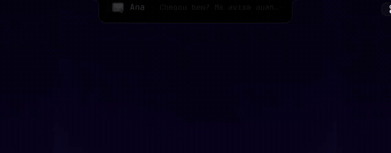
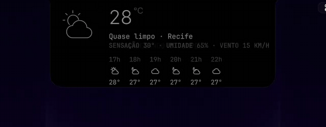

<div align="center">

# Island Notch

**A Dynamic Island for the Omarchy bar.**
Music, screen recording, dictation, notifications, Claude Code at work and the
volume and brightness indicators grow out of a notch in the middle of the bar, and
fold back into it.


</div>

## Why this one

- 🎵 **Music.** The album art and live waves while something plays (any MPRIS
  player); hover to expand into a player with progress, previous, play/pause and next.
- 🔴 **Screen recording.** A red dot and the elapsed time while Omarchy's screen
  recorder runs; hover for a stop button.
- 🗣️ **Voice assistant.** Optional, and asleep unless you bring your own: the notch ships
  no assistant. With a push-to-talk script named `assistente-voz` on your PATH, it can write
  its state to `$XDG_RUNTIME_DIR/assistente/notch.json`; the notch draws it like
  dictation: listening with the mic waves, thinking with what was heard, then the
  answer in the big card (a click opens the conversation).
  `omarchy-shell io.github.hugorolimf.island card ask` (or Tab or a click on an answer)
  opens the conversation: the day's thread from `notch.json` (`thread`, `dia`),
  your messages in bubbles, its answers as text, a box to reply under it. Enter
  hands the text to `assistente-voz texto <private file>` and the card stays;
  holding the talk key with it open listens inside it; NOVA runs `assistente --nova`.
  PENSAMENTO steps through Claude's five effort levels with a five-bar meter (click up,
  right click down; `assistente --esforco`, echoed as `esforco` in notch.json).
  Keys: ↑↓ scroll, ←→ walk PENSAMENTO/NOVA/ABRIR with the box empty, Tab or Esc close.
  An answer to a spoken question opens the conversation passive (no keyboard, no
  click-away grab): it stays while you keep talking and folds a while after the
  last answer; a click, Tab or the tap take it over for typing.
- 🎙️ **Dictation.** Listening and transcribing states for Omarchy's voice dictation
  (voxtype), in place of a separate pill.
- 🔔 **Notifications.** Each one drops in from the notch in a big card, long enough to
  read, then shrinks to a one-line mini view. Hover to expand, click to keep it open
  with its actions (reply, open, copy a code, close). It is its own notification
  server: history (read by [Island Inbox](https://github.com/hugorolimf/omarchy-island-inbox)),
  Do Not Disturb and Omarchy's notification keys (Super+, and friends) all work.
- ✳️ **Claude Code, live.** While a session works, the notch shows its state (working,
  waiting for you, done) and the current step as it rolls by: "Edits BarWidget.qml",
  "Runs: npm test", "Reads README.md". Several sessions: the latest one, "+N" for the
  others. Hover for the session's title, project and last three steps; a click
  takes you to its terminal (and tmux pane). Needs a Claude Code hook (below).
- 🔊 **Volume, brightness, microphone, keyboard.** Omarchy's on-screen indicators
  show in the notch instead of a card of their own; enabling this plugin takes over
  `omarchy.osd`, disabling it gives it back.
- ⏰ **Reminders.** A reminder set with `omarchy-reminder` counts down in the notch
  until it fires; a click lists them.
- 🌤️ **Weather card** on demand, from Omarchy's own weather location.
- 🌍 English and Portuguese, following your system language. Sized per monitor,
  drawn natively (no scaling blur).

## See it

Recorded on a real desktop, mouse and clicks included. The notch follows the
system language; these takes are in Portuguese.

**Music**: album art and live waves; hover for the player.


**Notifications**: it drops in, a hover expands it, a click keeps it open, and
you reply right there.



**Claude Code, live** (with the hook below): what the session is doing right now,
amber when it waits for you, a check when it's done; `+2` counts the other sessions.
A sample session here, not a real one.


**Volume and brightness**, in place of a separate on-screen card.


**Weather card**, on demand.



**Dictation**: listening, then transcribing.


**Reminder** counting down.


**Screen recording**: the elapsed time; hover for the stop button.


## Install

```bash
omarchy plugin add https://github.com/hugorolimf/omarchy-island-notch --enable
omarchy plugin disable omarchy.notifications
omarchy-restart-shell
```

The second line hands notifications over to the notch: it only serves them while
no other notifications service is on (otherwise each one would show twice), so
until then Omarchy's own cards keep showing them.

It takes the centre of the bar. Works with Omarchy's own bar and with
[Island Bar](https://github.com/hugorolimf/omarchy-bar).

## Talking to it

```bash
omarchy-shell io.github.hugorolimf.island notify '{"app":"Mail","title":"Ana","body":"Lunch?","icon":"mail"}'
omarchy-shell io.github.hugorolimf.island hud '{"key":"volume","value":0.4}'
omarchy-shell io.github.hugorolimf.island card weather
```

`notify` is how a script shows something in the notch (real notifications arrive on
their own);
`hud` is what the bundled on-screen display sends; `card weather` opens the weather
card.

Something that waits on you can stay until it's dealt with: a critical notification
with the `x-island-sticky` hint (`notify-send -u critical -h boolean:x-island-sticky:true …`,
or `"sticky": true` in `notify`) stays in the notch until it's closed or taken back
(`retract <id>`), and comes back after any other notification that showed over it.

## Claude Code

The live session comes from a small hook, `claude-hook.py` in this folder. The
plugin never edits your Claude Code settings: copy the hook somewhere stable and
register it yourself.

```bash
install -m 755 ~/.config/omarchy/plugins/io.github.hugorolimf.island/claude-hook.py ~/.local/bin/claude-notch-session
```

Then, in `~/.claude/settings.json`, add this entry to each of `SessionStart`,
`UserPromptSubmit`, `PreToolUse`, `PostToolUse`, `Notification`, `Stop`,
`SubagentStop` and `SessionEnd` under `"hooks"` (next to any hooks already there):

```json
{ "hooks": [{ "type": "command", "command": "~/.local/bin/claude-notch-session", "timeout": 5 }] }
```

The hook is Python 3 with no dependencies, prints nothing and always exits at once,
so it never changes what Claude does. It keeps only what the notch shows: the state,
each step as the tool and a short target (a file name, a command cut to 40
characters, a search pattern), the session's title (your `/rename`, else Claude's
own), the project folder and how to reach its terminal. Never your prompts, tool
output, file contents or the transcript. "Done" shows for a few seconds after a turn
ends, then the notch folds away; an empty turn, or Claude Code's own helpers
finishing, does not flash.

To keep Claude at work out of the notch and see only the notifications it sends,
add `"claudeWork": false` to the notch's entry in `~/.config/omarchy/shell.json`
(`{"id": "io.github.hugorolimf.island", "claudeWork": false}`).

If a notifier hook of yours leaves a notification's id in
`$XDG_RUNTIME_DIR/island-notch/claude/<session>.notif` (`{"id": 17, "at": <ms>}`),
for "Claude needs your permission", the hook takes that notification back once the
session moves on (you answered in the terminal): it is closed over D-Bus, leaves the
notch and the notifications history.

## Files it writes

- `~/.cache/island-notch/`: the weather forecast and detected location (10-minute
  and one-day caches).
- `~/.local/state/omarchy/io.github.hugorolimf.island/cover-<monitor>`: the height
  the notch takes at the top of each monitor, for window managers that keep windows
  clear of it.
- `~/.local/state/omarchy/notifications/history/` and `images/`: the notifications
  history, one JSON file each (the newest 100) plus copies of their images, and
  `~/.local/state/omarchy/notifications.json` (Do Not Disturb). The same places
  Omarchy's own notifications use, so history carries over both ways. Folders 0700,
  files 0600 (older ones are tightened at start); what a notification says is written
  through stdin, never put in a command line, and reaches the notch in process.
- `$XDG_RUNTIME_DIR/island-notch/reply.*`: an inline reply on its way to the
  sender, in a private (0600) file inside a 0700 folder, removed as soon as it is
  read. The reply text never goes in a command line.
- `$XDG_RUNTIME_DIR/island-notch/claude/<session>.json` (written by the Claude Code
  hook, read by the notch): one private (0600) file per session inside a 0700 folder,
  written to a temporary file and renamed. Removed when the session ends, or by the
  notch once its Claude process is gone. Gone at logout (it is in the runtime dir).
- `$XDG_RUNTIME_DIR/assistente/notch.watching`: only with `assistente-voz` on your PATH,
  the shell's pid, so the script knows the notch draws its states. A question typed in
  the card goes through a private file there (0600 in a 0700 folder), removed when read.

## Requirements

- Omarchy with the Quattro shell (Quickshell).
- Optional, each for its own part: an MPRIS player, Omarchy's screen recorder, Omarchy's
  voice dictation, `wl-copy` (copying codes), Claude Code with the hook above and
  `python3` (the live session).

## Remove

```bash
omarchy plugin remove io.github.hugorolimf.island
omarchy plugin enable omarchy.notifications
omarchy-restart-shell
rm -rf ~/.cache/island-notch ~/.local/state/omarchy/io.github.hugorolimf.island
```

If you added the Claude Code hook, take its entries out of `~/.claude/settings.json`
and delete `~/.local/bin/claude-notch-session`.

Omarchy's own on-screen display and notifications come back (the history stays).

## Credits

The on-screen display model (`OsdModel.js`) and IPC are Omarchy's `omarchy.osd`, and
the notification server (`NotificationService.qml`, `NotificationLogic.js`) and its
`notifications` IPC come from Omarchy's `omarchy.notifications`, both by
David Heinemeier Hansson and the [Omarchy](https://github.com/basecamp/omarchy)
contributors (MIT). Weather data from [Open-Meteo](https://open-meteo.com) (and
[wttr.in](https://wttr.in) to find your location when Omarchy has none).

## License

[MIT](LICENSE)
